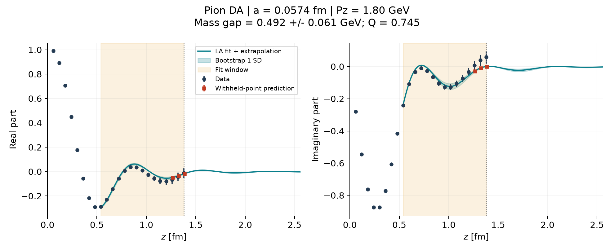
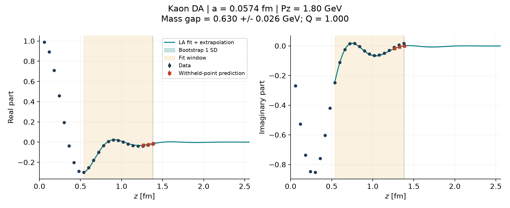
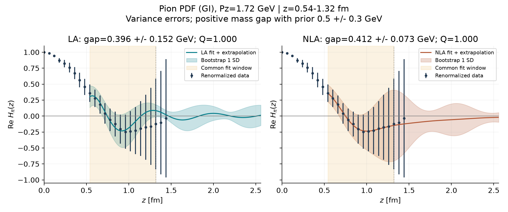
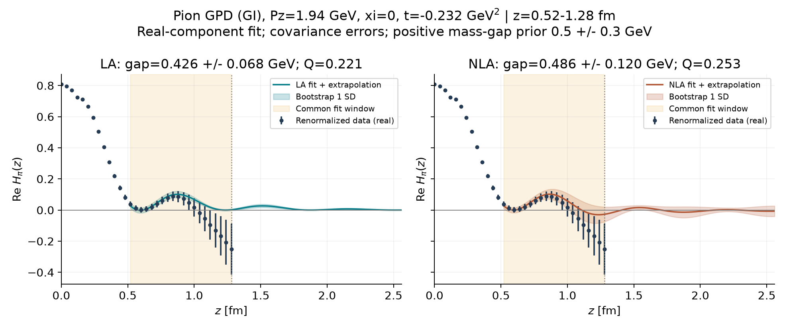
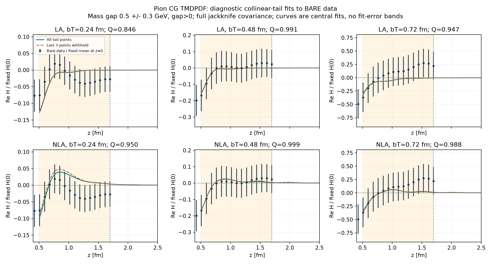

# DA, PDF, GPD and TMD tail test reports

These reports update interpretation and provenance of existing numerical results; no new numerical fits are claimed in this documentation update. Read DA.md, PDF.md, GPD.md and TMD.md with their matching plots. The positive physical mass-gap prior damps asymptotic oscillation amplitudes, so searching for a monotonic fit window is no longer part of the selection policy. Statistical fit quality and extrapolation uncertainty still need checking.

GitHub main was checked directly: both examples/pion_pdf_gi_manifest.json and examples/pion_pdf_cg_manifest.json specify variance. The main tail fitter silently falls back to covariance if the data attribute is missing. Local changes remove that fallback, bind/check manifest weighting during preparation, record it in diagnostics, and reject stale validation configurations/checkpoints. These protections are included in PR #43.

TMD results are diagnostic bare-TMDPDF fits with a collinear ansatz, not a validated production TMD asymptotic model. No TMDWF fit is claimed. Historical four-channel covariance PDF results are retained only as explicitly labeled historical data.

# DA test report

Documentation update using existing fit results; no new fit run.

## Shared tail-fit policy

The total physical mass gap uses a Gaussian prior 0.5 +/- 0.3 GeV with a strict positive bound. Its exponential factor exp[-gap*|z|/(hbar c)] automatically suppresses the amplitude of long-distance oscillations. At gap=0.5 GeV, the exponential factor decreases by about 0.079 per additional fm (before algebraic factors). This is damping of the envelope, not elimination of oscillatory phases, zero crossings, or finite-distance turning points; positivity alone allows arbitrarily slow decay near the bound.

Finding a good monotonic range is no longer needed. No monotonicity or matrix-element positivity preference is used. Retain usable upper-range data, scan lower boundaries with effective |z|min >= 0.5 fm, and require N_observations > N_parameters. Count real/imaginary observations separately when jointly fitted; do not count priors, replicas or reflected points as new data. Select admissible windows by the existing Q/logGBF rule, and assess model/window sensitivity and held-out data. The positive mass-gap prior is retained during posterior-prior refinement.

This explanation follows the model's exponential envelope. The existing tests do not constitute a controlled prior-on/prior-off study proving elimination of all Fourier ringing or model uncertainty.

## Evidence and limitations

18 renormalized pion/kaon GI channels, 600 bootstrap replicas each; joint real/imaginary fits with one_sigma errors. All selected models were LA, all Q >= 0.05, and selected/holdout sample failures were zero. Conditional last-three-point holdout pulls reach 3.52, so high Q does not establish predictive accuracy. Bootstrap bands exclude model/window and renormalization systematics.

| Channel | Gap [GeV] | Q | Max holdout pull |
|---|---:|---:|---:|
| kaon_DA_a06m130_P10 | 0.631 +/- 0.031 | 1 | 2.00 |
| kaon_DA_a06m130_P6 | 0.726 +/- 0.058 | 1 | 0.87 |
| kaon_DA_a06m130_P8 | 0.630 +/- 0.026 | 1 | 1.72 |
| kaon_DA_a09m130_P10 | 0.600 +/- 0.020 | 1 | 1.02 |
| kaon_DA_a09m130_P6 | 0.646 +/- 0.026 | 1 | 1.89 |
| kaon_DA_a09m130_P8 | 0.652 +/- 0.024 | 1 | 0.48 |
| kaon_DA_a12m130_P10 | 0.589 +/- 0.007 | 1 | 3.52 |
| kaon_DA_a12m130_P6 | 0.699 +/- 0.026 | 1 | 2.78 |
| kaon_DA_a12m130_P8 | 0.600 +/- 0.011 | 1 | 1.63 |
| pion_DA_a06m130_P10 | 0.526 +/- 0.087 | 0.997 | 0.76 |
| pion_DA_a06m130_P6 | 0.494 +/- 0.099 | 1 | 0.83 |
| pion_DA_a06m130_P8 | 0.492 +/- 0.061 | 0.745 | 1.49 |
| pion_DA_a09m130_P10 | 0.655 +/- 0.111 | 1 | 1.34 |
| pion_DA_a09m130_P6 | 0.649 +/- 0.108 | 1 | 0.25 |
| pion_DA_a09m130_P8 | 0.488 +/- 0.074 | 1 | 1.04 |
| pion_DA_a12m130_P10 | 0.556 +/- 0.048 | 0.999 | 1.24 |
| pion_DA_a12m130_P6 | 0.551 +/- 0.086 | 1 | 0.88 |
| pion_DA_a12m130_P8 | 0.499 +/- 0.057 | 0.121 | 2.63 |

# Pion PDF LA/NLA comparison

GI pion valence PDF, a=0.06 fm, P index 4, 200 archive bootstrap samples. Input prepared by hybrid renormalization with the repository example parameters and normalized at the origin. Sample error mode is variance, read from the GI manifest; no monotonicity or positivity constraint is applied to the matrix element.

Scan 15 LA center-fit windows: starts are the first five measured points at/above 0.5 fm, endpoints are the largest three measured points. Select using the package Q>=0.05/logGBF rule. Freeze the same selected window for LA and NLA and refit all 200 samples of each. Mass-gap prior is 0.5 +/- 0.3 GeV, with strict gap>0; other-parameter posterior-prior scale is 3. Each fit requires Nobs>Nparameters. Q and chi2/dof use the Bayesian fitter convention; data_dof is separately recorded.

Bands are bootstrap standard deviations conditional on the model/window and priors, excluding range-selection, model-choice and renormalization systematic uncertainties. Curves show the bootstrap mean; Q is from the central-data fit. This is a numerical tail-fit comparison, not an independent prediction test or end-to-end raw-correlator rerun. The shared window was selected using LA, not independently optimized for NLA.

Run run_comparison.py from the checked-out repository root with the earlier prepared input ../more-data/inputs/pion_PDF_GI_a060_P4.npz. The input is also included here for reproducibility. Results and curves are included.

## Shared tail-fit policy

The total physical mass gap uses a Gaussian prior 0.5 +/- 0.3 GeV with a strict positive bound. Its exponential factor exp[-gap*|z|/(hbar c)] automatically suppresses the amplitude of long-distance oscillations. At gap=0.5 GeV, the exponential factor decreases by about 0.079 per additional fm (before algebraic factors). This is damping of the envelope, not elimination of oscillatory phases, zero crossings, or finite-distance turning points; positivity alone allows arbitrarily slow decay near the bound.

Finding a good monotonic range is no longer needed. No monotonicity or matrix-element positivity preference is used. Retain usable upper-range data, scan lower boundaries with effective |z|min >= 0.5 fm, and require N_observations > N_parameters. Count real/imaginary observations separately when jointly fitted; do not count priors, replicas or reflected points as new data. Select admissible windows by the existing Q/logGBF rule, and assess model/window sensitivity and held-out data. The positive mass-gap prior is retained during posterior-prior refinement.

This explanation follows the model's exponential envelope. The existing tests do not constitute a controlled prior-on/prior-off study proving elimination of all Fourier ringing or model uncertainty.

## Existing numerical results

| Order | Gap [GeV] | Q | Observations / parameters |
|---|---:|---:|---:|
| LA | 0.396 +/- 0.152 | 0.999998 | 14 / 4 |
| NLA | 0.412 +/- 0.073 | 1 | 14 / 7 |

The authoritative example-aligned result here uses variance-only errors. Four PDF entries in the historical 22-channel expanded bundle used full covariance; those results are historical alternatives, not reproductions of the example settings. Earlier 0.48 fm / width 0.5 GeV trials are superseded.

# Pion GPD LA/NLA comparison

Archived GI pion GPD channel rn_qx0qy-1qz0: a=0.04 fm, L=64, longitudinal momentum index 4, xi=0, t=-0.2318387 GeV^2. Initial momentum [1,0,4], final [0,0,4]. This is a real-component numerical tail fit, preserving the archive sample_error_mode=covariance and its 200 bootstrap replicas. It is not a full complex GPD analysis or a fresh end-to-end pipeline run with the current paired-flow input contract.

Common window 0.52-1.28 fm is the earlier nine-window LA scan selection. Positive-z observations only: 20. LA has 9 parameters; NLA has 17, including parameters not separately identifiable from this real-only zero-skewness channel (stabilized by priors). A strict surplus of data counts is not proof of independent parameter identification. Total mass-gap prior is Gaussian 0.5 +/- 0.3 GeV with strict gap>0, lambda0=0; other-parameter posterior-prior scale=3. No monotonicity or positivity restriction on matrix elements.

Displayed curves and bands are bootstrap means and standard deviations conditional on model/window; Q comes from the Bayesian central-data fit. No range-selection/model-choice systematic uncertainty is included. Direct model predictions are shown rather than smoothed data/model joins.

Reproduction: run run_comparison.py from repository root with dataset_check.py and run_tests.py in its parent directory and the archived NetCDF at the path in dataset_check.py. Those helper scripts and the original input.nc are included. The input load in dataset_check.py can be redirected to the supplied input.nc.

## Shared tail-fit policy

The total physical mass gap uses a Gaussian prior 0.5 +/- 0.3 GeV with a strict positive bound. Its exponential factor exp[-gap*|z|/(hbar c)] automatically suppresses the amplitude of long-distance oscillations. At gap=0.5 GeV, the exponential factor decreases by about 0.079 per additional fm (before algebraic factors). This is damping of the envelope, not elimination of oscillatory phases, zero crossings, or finite-distance turning points; positivity alone allows arbitrarily slow decay near the bound.

Finding a good monotonic range is no longer needed. No monotonicity or matrix-element positivity preference is used. Retain usable upper-range data, scan lower boundaries with effective |z|min >= 0.5 fm, and require N_observations > N_parameters. Count real/imaginary observations separately when jointly fitted; do not count priors, replicas or reflected points as new data. Select admissible windows by the existing Q/logGBF rule, and assess model/window sensitivity and held-out data. The positive mass-gap prior is retained during posterior-prior refinement.

This explanation follows the model's exponential envelope. The existing tests do not constitute a controlled prior-on/prior-off study proving elimination of all Fourier ringing or model uncertainty.

## Existing numerical results

| Order | Gap [GeV] | Q | Observations / parameters |
|---|---:|---:|---:|
| LA | 0.426 +/- 0.068 | 0.221227 | 20 / 9 |
| NLA | 0.486 +/- 0.120 | 0.253267 | 20 / 17 |

# TMD diagnostic test report

Diagnostic only: collinear pion valence CG LA/NLA ansatz fitted to bare TMDPDF real component, p=(4,4,0), L=48 a=.06 fm as example geometry. No renormalization, phase change, or cross-file sample pairing. All 553 jackknife samples used for covariance; normalization is a fixed central constant, not fluctuating ratio. Fit starts at first grid point >=.5 fm (.50911688 fm), ends at 1.69705627 fm. Holdout fit ends at 1.44249783 fm, excludes last 3 points. Nobs=15/12 and Npar=5/8 for full/holdout and LA/NLA respectively. Positive mass gap prior .5 +/-.3 GeV; n>0. Other priors are package defaults. Q is Bayesian fit Q including priors. Holdout residuals divided by data SD omit fit uncertainty and interpoint correlations; they are diagnostics, not a calibrated predictive p-value. Curves have no uncertainty bands. This does not validate physical TMD asymptotics or renormalized FT. Native TMD workflow presently direct WF / tapered PDF, without these fits. WF not fit due to missing explicit phase-rotation provenance in extracted files. Source: supplied data_pion_tmd_cg.zip.

## Shared tail-fit policy

The total physical mass gap uses a Gaussian prior 0.5 +/- 0.3 GeV with a strict positive bound. Its exponential factor exp[-gap*|z|/(hbar c)] automatically suppresses the amplitude of long-distance oscillations. At gap=0.5 GeV, the exponential factor decreases by about 0.079 per additional fm (before algebraic factors). This is damping of the envelope, not elimination of oscillatory phases, zero crossings, or finite-distance turning points; positivity alone allows arbitrarily slow decay near the bound.

Finding a good monotonic range is no longer needed. No monotonicity or matrix-element positivity preference is used. Retain usable upper-range data, scan lower boundaries with effective |z|min >= 0.5 fm, and require N_observations > N_parameters. Count real/imaginary observations separately when jointly fitted; do not count priors, replicas or reflected points as new data. Select admissible windows by the existing Q/logGBF rule, and assess model/window sensitivity and held-out data. The positive mass-gap prior is retained during posterior-prior refinement.

This explanation follows the model's exponential envelope. The existing tests do not constitute a controlled prior-on/prior-off study proving elimination of all Fourier ringing or model uncertainty.

The policy above applies to the standalone bare-TMDPDF diagnostic tail fit. Production TMD direct/tapered transforms do not fit a mass gap and cannot be described as using prior-induced suppression. TMDWF has not been validated by this test.

## Code verification

169 focused Fourier/tail/error-mode tests passed; 265 unrelated tests were deselected. NetCDF tests used the existing test-only Windows Unicode-path wrapper. Two additional validation checks rejected a mismatched PDF error-mode configuration and a stale result checkpoint. Ruff passed for the Fourier module and changed test files. No full-suite pass is claimed; the separately observed pre-existing shared-prior contract failure is outside this fix.

GitHub main was read directly for both PDF example manifests and Fourier physics.py. Both manifests use variance, while main's low-level fitter silently defaults to covariance when the attribute is absent. PR #43 remains open. Its README conflict was resolved by retaining both the Fourier-tail and NNNLL documentation. The error-mode protections and regression tests are included in the branch.

## Fit plots

These plots show the existing numerical runs summarized above; the error-mode safeguards do not imply that the historical datasets have been refitted.

