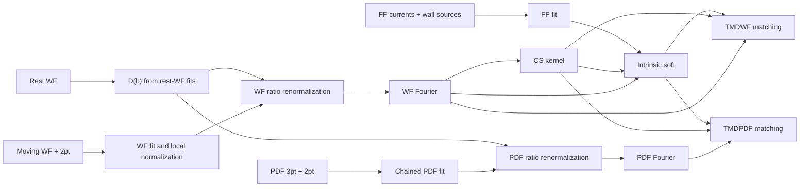

# Coulomb-gauge pion TMD analysis

The canonical example starts from the raw HDF5 correlators in `data_pion_tmd_cg` and runs
correlator analysis, ratio renormalization, Fourier transformation, soft analysis
and matching:

| Manifest in `examples/` | Perturbative analysis | Jobs |
|---|---|---:|
| `pion_tmd_cg_manifest.json` | NLL with explicit reference soft choices; real-only PDF Fourier | 516 numerical + final Review |

It uses the companion
`pion_tmd_cg_correlators.json` raw-channel descriptions and shared jackknife
propagation. No fitted results or imports from the historical analysis
repositories are required to run the example. Fixed-order NLO remains available
through the stage contracts; the validation sections below retain earlier NLO
and mixed-projection NLL runs as historical results.



The example computes **central results and statistical errors**, rather than
the full systematic-error bands of
[arXiv:2504.04625v5](https://arxiv.org/abs/2504.04625v5). NLL is now supported
with an explicit infrared prescription: the paper's soft integration boundary
can produce natural scales below the perturbative running-coupling domain.
The example selects the historical `reference_quad` procedure for direct
comparison; its pole-crossing integral is explicitly flagged as uncontrolled.

## Data and geometry

The ensemble lattice spacing is always **0.06 fm**. The PDF momentum is
`(n,n,0)` and its longitudinal displacement direction is `(1,1,0)`; the WF uses
`(n,0,0)` and `(1,0,0)`. Thus PDF longitudinal sites are separated by
`sqrt(2) * 0.06 fm`, without changing the ensemble lattice spacing. Both
momentum vectors and displacement directions are retained in the artifacts.
All transverse site indices have spacing 0.06 fm.

The example uses WF momenta 8, 9, 10, PDF momenta 3, 4, 5, and FF momentum 6.
The authored matching jobs request `bT/a=2..18` (0.12..1.08 fm). Additional local
`bT=z=0` correlators supply normalization. There is no transverse extrapolation.
The WF/FF valence pion mass is 0.67 GeV and the PDF valence mass is 0.30 GeV;
their own ensemble identifiers are preserved. Reusing the soft and CS
auxiliaries relies on their hadron-independent role at common lattice geometry,
not on identifying the two valence masses or their finite-momentum corrections.

The moving g14 WF is rotated by `-i exp(-i P.z/2)` once before fitting. The
zero-momentum reference uses g7. PDF three-point descriptors combine the
separations 6, 8, 10, 12. FF is a four-quark two-current correlator, fitted
with its wall-WF denominator; it is not an ordinary three-point/two-point ratio.

## Statistical conventions

The central example uses leave-one-out jackknife and bin size one, following
the reference correlator analysis. There is no authored bootstrap replica count.
The manifest retains its standard random-seed field, which does not affect
the deterministic jackknife samples.
The WF and PDF collections with 553 configurations have confirmed common
column ordering and share one sampling plan. The 20-configuration rest-WF
collection and the 100-configuration FF collection form independent groups.
This is an explicit independence approximation where subset mappings are
unavailable.

Before any fit, a common invalid-configuration mask is formed over the
selected fit domains of every correlator job in each group. The mask and
configuration identifiers enter the sampling-plan fingerprint. Invalid
entries are never replaced by random values. A different job subset can
therefore legitimately have a different mask; do not combine such results
as if their replicas were aligned.

Artifacts retain `replica_frame_id` and `resample_lineage`. Every operation
keeps replica order and merges lineage; overlapping groups must have the
same plan. In particular, the WF entering CS extraction is the same sampled
quantity reused in the soft integral and matching. Each native group has one
sample per retained configuration. At a cross-group merge, sorted independent
jackknife blocks vary one group at a time and hold other groups at their native
jackknife means. An additional central row propagates that central estimate;
it is not a statistical replica. With 544, 20 and 100 retained configurations,
the final array therefore has 664 delete-one evaluations plus one central row.
The covariance sums each group's contribution with its own `(N_g-1)/N_g`
weight. This preserves the original draws and shared factors throughout the DAG.
There is no jackknife bias correction. Raw replica quantiles are diagnostic
only and are not statistical confidence intervals.

## Numerical stages

Correlator time windows are half-open: `[tmin,tmax)`. Moving WF uses two-state
joint fits with SS `[3,11)` and both real and imaginary WF components on
`[5,10)` by default. The example's `qda_windows_by_z` mappings reproduce the
historical coordinate-specific exceptions corresponding to the intermediate
results in `data_pion_tmd_cg`, including the local normalization windows.
Nonlocal windows match reference commit `5b488b70` (November 2024); local
windows match `2fe09203` (December 2024). These differ from the current
reference script. See the provenance discussion in
[reference comparison](tmd-reference-comparison.md).
Each channel is conditioned separately and the physical amplitude
is recovered. The WF output convention is `O00/E0`. The rest-WF real channel
uses a one-state fit `[10,16)` for nonlocal separations and `[12,16)` for the
local normalization, matching the archived cache's generating notebook.
Fitting both rest components with a full covariance is unstable for this
20-configuration sample; the example retains its real channel. PDF uses a chained
two-state SS `[3,13)` and ratio fit over separations 6,8,10,12, with a three-site
insertion cut. These are explicit starting windows, with fit diagnostics
published for inspection.

All TMD jobs explicitly use `sample_prior_mode="original"`: each jackknife
fit uses the authored physical prior, with the center fit providing only
the optimizer's initial guess. The PDF chain transfers each replica's
two-point posterior with its original width (`chained_prior_error_scale=1`).
`posterior_prior_error_scale=10` does not broaden original-mode priors, and
the explicit chain scale overrides its fallback role. Existing collinear
examples keep their own settings and defaults.

The example uses the common [prior interface](fit-priors.md) to specify
reference priors whose model parameters agree exactly: moving-WF
`log(dE1)=-1±0.3`, raw `log(overlap0)=-25±5`, both `phi0` components `0±0.5`; the raw
rest amplitude `0±0.5`; the PDF log gap `0±10`; and the four FF priors.
Widths are applied before numerical conditioning, and diagnostics record
the resulting effective priors. Parameters omitted from `priors` retain
the fitter's physical defaults. A linear Gaussian energy prior from the
reference is not substituted for a Gaussian in log energy: those are
different probability distributions. The present positive-energy and
excited-WF parameterizations therefore remain deliberate differences.

FF fits the four X, Y, X5, Y5 insertions with a common sampled wall denominator,
then averages them. Its physical normalization uses the spatial volume
`48**3`, the computed momentum, and an explicitly supplied energy 2.67 GeV.
The example uses separations 8 and 10, as in the archived FF notebook.
The paper's larger 6,8,10,12 window was tested first, but produced poor axial-current
fit quality on these inputs; the narrower central window is recorded explicitly.

WF local normalization uses the real local axial matrix element, retaining
its replica errors. Jointly fitting both WF components does not introduce
an extra rotation from the local imaginary noise. Local normalization precedes division by
`D(b)=A0(b,0)/A0(0,0)`. The same sampled ratio factor renormalizes PDF.
The WF reference-application jobs explicitly set `projection: "real"`, zeroing
the normalized WF's imaginary part as in the reference script. This does not
change the fitted bare WF or the real samples and their uncertainties. TMD ratio
jobs default to `projection: "preserve"`; PDF retains its authored components.
The centered real WF is directly Fourier transformed with the `x-1/2`
convention. PDF uses the `x` convention and tapers linearly between longitudinal
sites 13 and 20. Its projection is an explicit per-job choice:

| Fourier `projection` | Correlator channels retained | PDF output sector |
|---|---|---|
| `real_even` (default) | Real channel through `Re(h) cos(x P z)` | `valence` |
| `hermitian` | Both channels through `Re(h) cos(x P z) + Im(h) sin(x P z)` | `full` |

The Hermitian choice uses the negative Fourier phase and requires an upstream
artifact with `output_component="both"`. Missing imaginary-channel fits cannot
be replaced with zero silently. Both projections produce a real x-space
distribution; that does not make their sectors equivalent. Provenance retains
the source components, Fourier projection, phase sign and sector.

The canonical `pion_tmd_cg_manifest.json` explicitly selects `real_even` for all
51 PDF Fourier jobs, so P3/P4/P5 use only the real matrix element and share the
valence projection. Its pion isovector convention is `u-d=2 Re(connected-u)`, with the
factor two applied once at matching; see
[arXiv:1905.06349, Sec. VI.1 and Appendix C](https://arxiv.org/abs/1905.06349).
The packet's quasi and matched x-space references follow the same real-even
prescription as its fixed-x transverse curves and paper exports. The preparation
script `runs/pion_tmd_cg/prepare_reference_data.py` uses reference-repository
matrix-element samples, rest normalization, soft function, physical CS kernel,
and NLL coefficient code. It verifies all 153 transverse centers and errors to
floating-point precision. The reconstructed reference has no agent inputs.
Existing complex correlator fits may still supply the input: the explicit
Fourier projection controls which channel enters the distribution.

In the original NLO example, soft jobs implement two operations:

- `type=cs_kernel`: hard-corrected ratios of WF momenta `(8,9)` and `(9,10)`,
  averaged over `x in [0.34,0.66]` for each replica and transverse distance.
- `type=intrinsic_soft`: divide WF by its hard factor, evolve to FF momentum
  using the physical CS kernel, fit `c[x(1-x)]**n` to the endpoint shoulders,
  and integrate over `[0.05,0.95]**2`. The Sudakov coefficient uses FF momentum.
  The example explicitly authors the reference Gaussian endpoint priors as
  `priors={"c":"1.0(3.0)","log(n)":"0.0(3.0)"}`.
  The prior on `c` is in linear physical units; `log(n)` uses the natural
  logarithm. Every replica uses these same priors. Omitting this field keeps
  the unregularized endpoint fit. Diagnostics distinguish data and prior
  contributions to chi-squared.
  Deterministic quadrature is checked at doubled resolution, and the three
  WF-momentum determinations are averaged with equal weights within each
  replica. Their full covariance is retained: the variance of the average is
  `sum(C_ij)/9`. This follows the reference analysis's arithmetic average;
  a separate common-constant fit diagnoses momentum dependence without
  changing the central estimator or adding a systematic-error band.

The [NLO coefficient definitions](../lamet_agent/kernels/tmd/cg_nlo.md) and
[NLL coefficient definitions](../lamet_agent/kernels/tmd/cg_nll.md) specify the
corresponding truncation, resummation and infrared conventions shared by soft
analysis and matching. Inputs with different coefficient provenance cannot be
combined silently.

`diagnostics/cs_pairs.nc` retains the unaveraged CS replicas for every
transverse distance, momentum pair and selected x. Soft JSON diagnostics
also include endpoint-parameter covariance, quadrature convergence, and
momentum consistency.

Matching multiplies each quasi distribution by `sqrt(SI)`, divides by its
appropriate hard factor, and applies physical CS rapidity evolution. The example
use `mu=2 GeV`, `alpha_s=0.293`. WF is evolved to momentum index 10; PDF uses
`zeta=4 GeV**2`. PDF's explicit `flavor_factor=2` is applied once. For the
real-even valence projection it converts `(u-d)/2` to `u-d` at all three momenta.
WF output covers `x=0.1..0.9`; PDF covers `0.2..0.9`. At the lowest PDF momentum,
strict NLO's hard factor is nonpositive near `x=0.1`, while the reference NLL
natural scale there lies below its running-coupling pole. Invalid hard
factors are rejected, not clipped. These output limits are numerical domains,
not a claim that power corrections vanish throughout them.

## NLL and reference soft choices

`pion_tmd_cg_manifest.json` uses `nll` for soft analysis and matching, retaining
the upstream fit windows, priors, normalization and shared sampling groups.
PDF Fourier uses the real-even projection at every momentum.
The hard coefficient uses a tree-level boundary, two-loop
cusp and one-loop noncusp anomalous dimensions. The Sudakov coefficient uses
the paper's Appendix A evolution. Running uses the reference's analytic NNLO
coupling approximation, with three flavors and the supplied `alpha_s(mu)`;
this convention does not make the coefficient NNLL.

The intrinsic-soft job explicitly authors the following reference choices:

| Field | NLL reference example | Effect |
|---|---|---|
| `evolution_cs` | `quasi_ratio` | Use the uncorrected WF momentum-ratio CS value in soft evolution, reconstructed from the same physical-CS replicas and saved hard correction. |
| `sudakov_momentum` | `quasi` | Use each source WF momentum in the Sudakov kernel; rapidity evolution still targets the FF momentum. |
| `endpoint_fit_points_per_window` | `20` | Cubically interpolate raw quasi replicas to 40 total shoulder points before hard division and evolution. |
| `endpoint_central_points` | `100` | Use the reference central interpolation grid on `[0.3,0.7]`. |
| `endpoint_covariance` | `reference_cs_diagonal` | Preserve quasi covariance and add CS uncertainty diagonally in the endpoint fitting metric. |

These are explicit reproduction choices, not changes to the default physical
CS evolution, FF kernel momentum or full endpoint covariance. The diagonal
CS term affects fit weights only: each endpoint fit uses the original aligned
replicas, and soft/matching still retain shared WF/CS covariance. There is no
independent CS redraw and no removal of correlator correlations between tsep
blocks. The endpoint priors remain `c=1±3`, `log(n)=0±3`; low-Q fits remain in
the output with diagnostics rather than being selected away.

At `mu=2 GeV`, `alpha_s=.293`, the reference coupling has a pole at
approximately **0.3919103962 GeV**. The kernel exposes three policies:

- `error` is the default and rejects scales at/below the pole before integration.
- `freeze` requires a `freeze_scale_gev` above the pole and at/below `mu`.
  Both hard and Sudakov coefficients use `Q_eff=max(Q,freeze_scale_gev)` in
  their boundary, coupling and logarithms. This declared infrared model
  plateaus below the floor; physical hadron momentum and rapidity evolution
  remain unchanged. For example, select `freeze_scale_gev=1.0` consistently
  in both soft and matching defaults.
- `reference_quad`, explicitly selected in the new example, retains the
  historical `scipy.integrate.quad` variable and tolerance. It records pole
  crossings, warnings and estimated errors. A finite returned number or
  agreement of the outer two-dimensional quadrature does **not** establish
  convergence of a pole-crossing inner Sudakov integral. Hard coefficients
  still reject nonpositive coupling values.

Integration kernels are cached and applied to every replica. Independent
deterministic node doubling remains in place; the reference's Monte Carlo
integration of separate mean-minus/plus-error curves is not used for statistical
propagation. Stage reports retain the infrared prescription and its diagnostics.
The saved `data_pion_tmd_cg` results remain the comparison target; choosing NLL
does not imply exact equality of mixed-version cached results or their errors.
Actual comparisons are recorded in [reference comparison](tmd-reference-comparison.md).

## Running and debugging

```bash
lamet-agent validate examples/pion_tmd_cg_manifest.json
lamet-agent run examples/pion_tmd_cg_manifest.json --provider codex --model MODEL_ID

lamet-agent validate examples/pion_tmd_cg_nll_manifest.json
lamet-agent run examples/pion_tmd_cg_nll_manifest.json --provider codex --model MODEL_ID
```

Choose a model available from the configured provider. All tuning parameters
are authored, so the numerical stages need no model recommendations. The
NLL example has no Review job. The original NLO example's
final Review uses the backend to inspect numerical evidence, read literature,
and write the scientific report. Its deterministic checks audit all upstream
jobs even though the manifest selects a smaller set of representative curves
for the model. The model also receives stage-wide center-fit quality counts,
including unselected jobs; missing fit diagnostics are distinguished from
zero failures. Use a fresh artifacts directory for each run. For iterative
debugging, copy the manifest, reduce the common transverse grid to 4 and 8,
and keep only the desired stage prefix. Jackknife always uses all retained
configuration bins; it has no independently adjustable replica count. Keep local
normalization jobs and filter the soft input lists consistently. Once a stage
passes, add the next stage; downstream-only debugging may use the existing
`{"file":".../output.nc"}` input form. Shared inputs must retain their original
replica frame and lineage.

Inspect the stage reports, `summary.json`, numerical diagnostics, and plots.
The packet's saved intermediate results are the primary comparison target.
Exact equality is not expected where the pipeline propagates normalization
errors, excludes invalid raw configurations, or uses a different perturbative
order or explicit soft prescription. These differences must be quantified
explicitly. Full systematic scans, transverse tails, and the transform to
transverse momentum remain outside both examples.

## Historical NLL validation with mixed PDF projections

`runs/pion_tmd_nll_packet_projection` completes the NLL example's **516
numerical jobs**: 140 correlator, 170 normalization/renormalization, 102
Fourier, two soft and 102 matching jobs. This incremental raw-data continuation
recomputed 136 jobs affected by retaining both P3/P4 PDF components and reused
380 verified agent outputs. No reference packet product was a numerical input,
and no scientific Review ran. All 140 correlator jobs participated in the
configuration preflight; the 544/20/100 retained configuration groups and their
shared downstream lineage were preserved.

All outputs pass finite-value, geometry, jackknife-error and lineage checks.
The source and upstream hashes stayed unchanged during the continuation.
The 34 new complex PDF jobs contain 714 center fits; four have Q<0.05,
the minimum is 0.02968, and no replica fits failed. Independent signed-z
Fourier reconstruction agrees to 1.45e−15 and independent matching reconstruction
agrees exactly. The complete test suite passes **1066 tests**; Ruff and
whitespace checks pass. The original four example manifests remain unchanged,
with their numerical compatibility covered by regression tests.

All 17 CS and 17 intrinsic-soft central values, and all 912 points across
the 12 available matching reference curves, differ by less than one saved
reference error. This describes agreement with the saved packet, not an
independent statistical test or reproduction of the paper's systematic bands.
The explicit P3/P4 full versus P5 valence distinction and the `reference_quad`
infrared diagnostics above remain material limitations. See the
[final comparison and validation links](tmd-reference-comparison.md#pdf-projection-identified-in-the-saved-reference)
for the numerical evidence and plots.

## Historical fixed-order NLO jackknife validation

The fixed-order NLO raw-data jackknife run is `runs/pion_tmd_packed_jackknife`. Its
[stage comparison](tmd-reference-comparison.md) tracks the revised example
against archived correlator, renormalization, Fourier, soft and matching results.
Native groups retain 544, 20 and 100 configurations. Regression tests cover
unequal group sizes, the weighted covariance formula, shared-factor cancellation
through both matching branches, a nonzero correlated CS kernel, NetCDF round trips,
and the exact configuration-filter domain for per-z fitting windows.
At that NLO validation checkpoint, the implementation passed **1039 tests**; Ruff, manifest validation,
and whitespace checks also pass. The four original example manifests are
byte-identical to their existing versions. Their compatibility tests also verify
bitwise-identical fit outputs with forced worker recycling between maps.

The raw validation was checkpointed after 41 complete correlator jobs to
bound long-lived worker memory. Repeated correlated gvar allocations made
an otherwise identical fit 6.8–7.6 times slower in a controlled benchmark.
Rebuilding the worker processes between completed maps preserves fit values,
posterior covariance and chained-prior results exactly in the replay.
`continuation.json` records the sole process-lifecycle source change and the
hashes of restored outputs and summaries. The complete 517-job manifest and
its common configuration preflight are retained. Unfinished jobs continue
from raw correlators; no reference cache or earlier bootstrap result is
restored as a production input.

All 140 correlator jobs finish with finite outputs and no recorded failed
replica fits. Center-fit quality remains a separate limitation:

| Channel | Center fits with Q below 0.05 / total |
|---|---:|
| Moving WF | 41 / 1074 |
| Rest WF | 1 / 18 |
| PDF | 20 / 1071 |
| FF, four currents | 37 / 68 |

The minimum FF Q is 9.01e-9 and its median is 0.0266. This does not support
describing the FF fits as uniformly adequate. Actual WF and four-current FF
plots, spectra, all center-fit records, and the common configuration mask are
saved in `runs/pion_tmd_packed_jackknife/reference_comparison/ca_validation.json`
and its companion figures. Comparisons also identify two pathological saved
WF coordinates whose reference replicas have zero variance; those reference
errors are not treated as valid denominators for normalized differences.

The poor large-b FF quality is also present in the historical reference logs.
At b/a=18 the four current Q values are approximately
`2.85e-5, 8.27e-8, 6.77e-4, 2.10e-6` here, versus
`2.1e-5, 3.1e-8, 3.4e-4, 6.5e-7` in the rounded first-jackknife logs.
Both show severe tension; matching those reference central values does not
validate the fit model. The present sample-0 plots show a systematic residual
for the t=10 data. The b/a=4 current fits are appreciably better.

The run finishes all **516 numerical jobs** over the authored b/a=2..18
domain: 140 correlator, 170 renormalization, 102 Fourier, two soft, and
102 matching outputs. Every numerical output is finite; the final matching
arrays retain all three sampling groups (664 delete-one evaluations plus
the propagated central row). All intrinsic-soft evaluations are positive.

| bT (fm) | CS kernel, central ± stat | Intrinsic soft, central ± stat |
|---|---:|---:|
| 0.24 | -0.3663 ± 0.1873 | 0.49594 ± 0.07895 |
| 0.48 | -0.5962 ± 0.2913 | 0.22333 ± 0.05729 |
| 0.72 | -0.7599 ± 0.4774 | 0.09326 ± 0.04002 |
| 1.08 | -1.1430 ± 1.1310 | 0.06689 ± 0.06582 |

Doubling integration nodes changes the denominator by at most 8.63e-5
relative or 9.86e-5 statistical errors. Endpoint center-fit Q values are
at least 0.1038. However, the diagnostic common-momentum fit has Q below
0.05 at b/a=2..8; the published arithmetic average does not include
momentum-dependent power corrections in its uncertainty. The last soft
point has an error comparable to its central value. Successful local
delete-one evaluations do not demonstrate that a broader fluctuation
distribution is free of nonlinear or logarithm-domain instability.
These remain fixed-order NLO central results with statistical errors only.

The automatic scientific Review also completes, giving **517 jobs** including
Review and zero deterministic consistency findings. Since the unversioned
built-in literature entry retrieved a newer online paper, an additional Review
explicitly reads the user's local `2504.04625v5.pdf`. Its report is
`runs/pion_tmd_packed_jackknife_v5_review/artifacts/06_review/review/review.md`.
All 6355 files of the 516 numerical jobs are verified byte-for-byte before and
after this reuse; no numerical fit or transform is repeated. The v5 PDF and
extracted text hashes are retained in that run's `provenance.json`. The complete
text is archived; the model's text limit covers the main article through the
conclusions/acknowledgements but not every appendix. Both scientific Reviews
identify the low-Q FF fits, soft momentum dependence and endpoint/large-b
limitations above. A clean consistency audit is not a scientific quality pass.

## Historical bootstrap validation evidence

This section records the earlier bootstrap runs. It does not describe the
revised jackknife example or its output domain.

The earlier raw-data run is `runs/pion_tmd_reference500`. It completed all
**140 correlator, 170 renormalization and 102 Fourier jobs**, using 500
bootstrap replicas. A process termination interrupted the correlator stage;
85 completed outputs and summaries were restored byte-for-byte under the same
full manifest, preserving job indices and the full-domain configuration mask.
`continuation.json` records those hashes. `source_snapshot.json` and
`review_source_snapshot.json` distinguish the frozen numerical source from a
subsequent reporting-only fix that exposes all-job fit quality to Review.

The complete test suite passes **996 tests**; manifest validation, Ruff and
`git diff --check` also pass. All 140 correlator outputs are finite, with zero
failed sample fits. Numerical completion does not establish fit adequacy.

| Quantity | Current 500-bootstrap result | Archived analysis |
|---|---:|---:|
| WF P=8, b/a=4, z=0 | 0.11132 ± 0.00398 | 0.11234 ± 0.00409 |
| PDF P=5, b/a=4, z=0 | 0.65915 ± 0.03508 | 0.6559 ± 0.0352 |
| FF b/a=4 | 0.480720 ± 0.002927 | 0.480270 ± 0.002062 |
| FF b/a=8 | 0.169686 ± 0.002658 | 0.169755 ± 0.001629 |
| FF b/a=18 | 0.009371 ± 0.000447 | 0.009474 ± 0.000216 |

All 17 FF replica arrays exactly reproduce the earlier controlled
original-prior rerun. The former large-b FF central-value shift came mainly
from broadened center-posterior replica priors, not the choice to retain full
covariance. Archived FF errors lose cross-current covariance when separate
GVars are reloaded, so their smaller errors are not the target here.

The full authored fit domain excludes raw configuration indices 85, 115,
317, 338, 383, 472, 476, 514 and 517 from the shared 553-configuration group.
The rest-WF and FF groups retain all 20 and 100 configurations. The earlier
64-replica, two-distance debug run excluded only 472 and 476; differences
between those runs cannot be attributed to replica count alone.

| Channel | Center fits with Q below 0.05 / total |
|---|---:|
| WF P=8 | 17 / 358 |
| WF P=9 | 39 / 358 |
| WF P=10 | 10 / 358 |
| Rest WF | 2 / 18 |
| PDF P=3 | 67 / 357 |
| PDF P=4 | 0 / 357 |
| PDF P=5 | 0 / 357 |
| FF, four currents | 39 / 68 |

The FF minimum center Q is 2.28e-8; the b/a=18 YY fit has visible residual
tension. Large-b PDF signals span zero. Twenty-seven representative WF energy
comparisons differ by at most 0.40 current posterior standard deviations
from rounded reference first-jackknife estimates; this is a descriptive
comparison between different estimators. Nine actual fit plots were inspected.
Replica-Q distributions are also saved, but are not independently calibrated
null-distribution tests: bootstrap draws fluctuate around already noisy data.

### Historical bootstrap real-log domain limitation

The full run **stops at CS extraction** with its authored `[0.34,0.66]` window.
At b/a=18, P=10, replica 66 has quasi-WF -0.002427665 at both endpoint x values.
The P=9 value is positive, giving a hard-corrected ratio -0.01874355. A real
logarithm is undefined. No replica is clipped, removed, redrawn, or converted
with an absolute value. Current full-range soft/matching outputs and its final
scientific Review have therefore not been produced.

A separate run, `pion_tmd_reference500_valid_domain`, keeps the original
`[0.34,0.66]` interval and completes the mathematically defined b/a=2..17
subdomain. It retains all 412 upstream outputs, including b/a=18, and adds
two soft and 96 matching jobs: **510 numerical outputs**, all finite with
500 replicas and consistent three-group lineage. This is an explicitly
limited result, not a completed b/a=2..18 analysis. All 8000 soft replicas
are positive. Doubled quadrature changes are below 0.000699 relative and
0.00436 statistical errors.

| bT (fm) | CS kernel | Intrinsic soft | Soft median [16th, 84th percentiles] |
|---|---:|---:|---:|
| 0.24 | -0.1754 ± 0.1834 | 0.5963 ± 0.0969 | 0.5834 [0.5048, 0.6878] |
| 0.48 | -0.3695 ± 0.2902 | 0.2764 ± 0.0787 | 0.2607 [0.2107, 0.3369] |
| 0.72 | -0.6069 ± 0.4881 | 0.1142 ± 0.0652 | 0.0982 [0.0685, 0.1543] |
| 1.02 | -1.0055 ± 1.0701 | 0.1307 ± 0.3235 | 0.0666 [0.0298, 0.1598] |

These are fixed-order NLO results with statistical errors. The valid-domain
matching outputs retain 81 WF and 71 PDF x points. Large-b skewness and the
upstream fit-quality limitations still apply. Its actual scientific Review
has completed after reading the local v5 paper: **511 jobs including Review**.
The deterministic audit has zero errors, warnings, or not-checkable findings,
while the scientific report flags low FF fit quality, soft momentum-consistency
Q below 0.05 at b/a=2..7, and endpoint/large-b limitations. The model receives
all 2231 center-fit quality records as stage-wide aggregates. These clean
metadata checks do not establish physical fit adequacy.

The report is saved under
`runs/pion_tmd_reference500_valid_domain/artifacts/06_review/review/review.md`;
`validation.json` beside that run's artifacts records the 510-output numerical
audit. An additional upstream-only scientific Review also completed separately.

Independent cosine summation reproduces the stored Fourier values, and all
51 input arrays pass replica-order/lineage checks. The reference's exact
archived x endpoints (approximately 0.34184 and 0.65816) also yield a negative
value for this draw. Replaying its pre-existing z=4,6 fit-window exceptions
makes the negative values slightly worse; exact active-prior replays change
amplitudes by at most 0.023 current standard deviations. This is a genuine
statistical support problem, not an identified implementation defect.

A separately labeled diagnostic uses a common `[0.35,0.65]` CS window for
all momenta, distances and replicas. It preserves all 500 draws and produces
positive soft values across the full transverse range. For b/a<=17 the CS
mean shifts by at most 0.118 of the original statistical error. This window
change is **not yet adopted in the example**; it changes the authored analysis
choice and awaits the user's decision.

Even that diagnostic does not establish a stable large-b estimate. At b/a=18
its soft median is 0.0771 and its 16th–84th percentile interval is
[0.0285,0.2170], but its mean and standard deviation are 0.569 and 6.869.
Replica 32 alone supplies 52.65% of the sample sum: gamma=+6.683 suppresses
the evolved WF strongly, producing SI=149.8. Quadrature refinement and
multistart endpoint fits reproduce the outlier. It mainly reflects nonlinear
CS uncertainty propagation; boundary-constrained endpoint exponents are an
additional model limitation. Quoting only a mean plus/minus standard deviation
would obscure this instability.

The updated [reference comparison](tmd-reference-comparison.md) records the
failure coordinates, controlled checks, and diagnostic plots. Previous
completed NLO runs used different correlator priors/windows and must not be
presented as validation of this full-chain prior-fidelity configuration.
